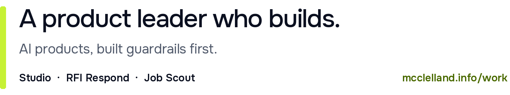

<picture>
  <source media="(prefers-color-scheme: dark)" srcset="assets/header-dark.png">
  
</picture>

Twenty years in product at Google, Bumble, Babbel, and Soho House. I now design and build AI products of my own, with guardrails, privacy, and safety designed in from the start.

Case studies and build notes: [mcclelland.info/work](https://mcclelland.info/work/)

**What I build**

I run my builds like a small engineering team with AI agents in the seats: stories refined into test cases, tests first, continuous integration, evaluation sets, and red teams. I write the stories and tests, and decide what ships.

- **[Studio](https://github.com/rorymcclelland/studio)**: a multi-agent campaign studio for marketing teams, in build, with a real person approving every consequential move. [Case study](https://mcclelland.info/work/studio/)
- **[RFI Respond](https://github.com/rorymcclelland/RFI-responder)**: AI drafting for RFIs and security questionnaires, grounded in an organisation's own knowledge base, with a real person approving sensitive answers. [Case study](https://mcclelland.info/work/rfi-respond/)
- **[Job Scout](https://github.com/rorymcclelland/job-scout-demo)**: an agentic job search in daily use. Personal data is processed on my own machine, and it never applies on my behalf. [Case study (PDF)](https://mcclelland.info/case-studies/rory-mcclelland-job-scout-case-study.pdf)
- **[Task oversight](https://github.com/rorymcclelland/task-manager)**: one prioritised list from AI assistants, a task manager, and local notes. [Case study (PDF)](https://mcclelland.info/case-studies/rory-mcclelland-task-oversight-case-study.pdf)

The method behind them: [How I build with AI](https://mcclelland.info/case-studies/rory-mcclelland-how-i-build-with-ai.pdf) (PDF).

I started as an engineer and have managed an engineering team, so I can talk through trade-offs with engineers in their own terms.

**Writing:** [mcclelland.info/writing](https://mcclelland.info/writing/)

**Get in touch:** [hello@mcclelland.info](mailto:hello@mcclelland.info) · [LinkedIn](https://linkedin.com/in/rorymcclelland)
